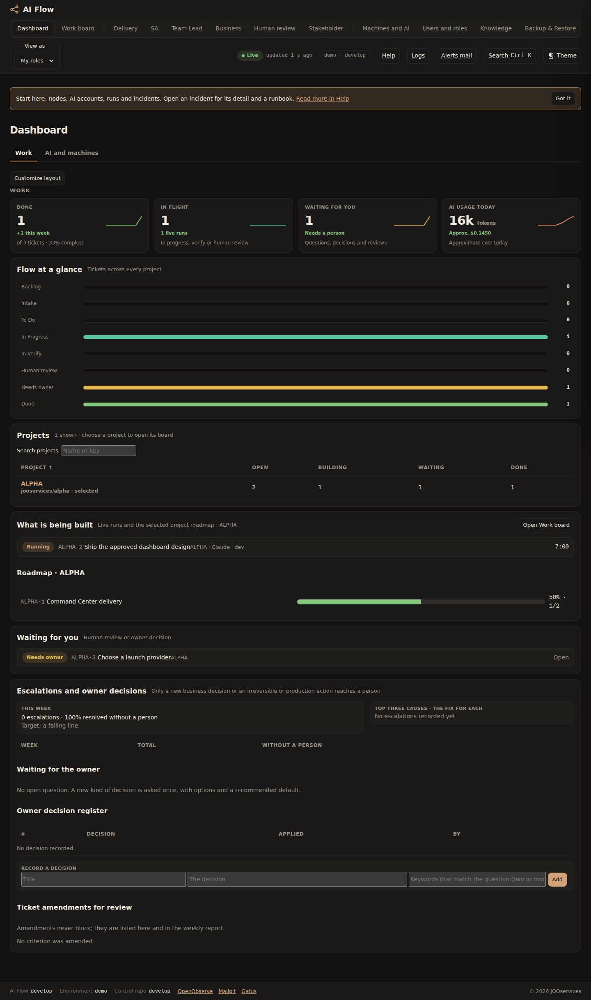
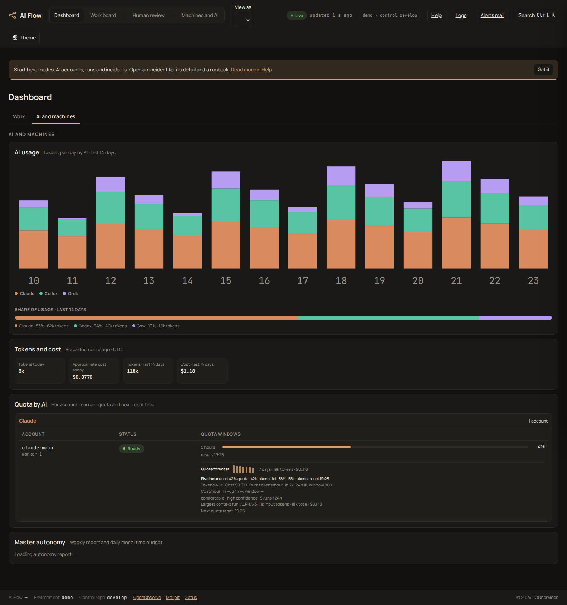

# Command Center Dashboard V2

**Console screens:** Command Center (`cc`), Work board (`work`), Delivery (`delivery`), Human review (`review`), SA (`sa`), Machines and AI (`machines`), Users and roles (`users`), Team lead (`lead`), Business (`business`), Stakeholder (`stakeholder`), Knowledge (`knowledge`), Backups (`backup`), Integrations (`integrations`), Projects (`projects`), Licensing (`licensing`), Notifications (`notifications`), and Support (`support`).

The Dashboard follows the approved V2 layout. It opens in the **Work** tab and also has an **AI and machines** tab.
The Work tab has four linked summary cards: Done, In flight, Waiting for you, and AI usage today. Done counts
non-epic tickets in Done, shows the share of all non-epic tickets, and counts tickets completed during the current
seven UTC days. In flight counts tickets in In Progress, In Verify, or Human review. Waiting for you follows the
Human review queue: questions and decisions, human reviews, and tickets with an open blocker. AI usage today sums
recorded input and output tokens and cost for the current UTC date. Each card includes a short trend line and an
explanatory line.

Done and In flight open the Work board with the matching status filter. Waiting for you opens Human review when the
person has that permission; otherwise it opens the Work board filtered to waiting tickets. AI usage today opens the
AI and machines tab. The Work tab's Flow at a glance steps open the Work board with the selected Jira status.

The AI and machines tab charts recorded tokens by AI provider and UTC day over the last 14 days, shows each AI's
share of those tokens, and shows the existing per-account quota and reset details to people with Machines and AI
access. The dashboard usage aggregation reads AI provider runs in the `runs` table, excludes human review records,
and is scoped to the signed-in person's visible projects. The quota panel reuses the account quota and usage data
already shown on Machines and AI.

Dark is the default theme across the console. A person can switch to light from the theme control in the menu. The
choice is saved against the signed-in account, so it follows that person across browsers; the browser's local
preference is used as a fallback when the console API is not available.

The per-person theme preference is read with `GET /v1/console/preferences` and saved with
`PUT /v1/console/preferences`. Daily AI usage by provider is returned by
`GET /v1/analytics/usage/daily?days=14`.

Dashboard ticket totals and the Done this-week trend use the shared ticket snapshot from `GET /v1/state`. The same
snapshot helper serves deployment clients through `GET /v1/deploy/state`; each ticket includes its `done_at` value.

## Dashboard screenshots

These Playwright captures use representative run, ticket, and quota data. I compared each view with the approved
V2 reference in `design/command-center-v2.html`; the warm dark palette, four summary cards, clickable funnel, usage
chart, share bar, and quota-by-AI section follow its layout.

